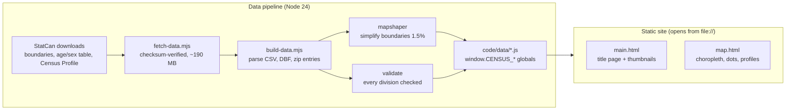

# Canadian Census Viewer

**Run it:** clone the repo and open `code/main.html` in a browser. You don't need a server or an install.

I started this in 2024 to map ward populations in London, Ontario. It grew into an atlas of all 293 census divisions in Canada, built from Statistics Canada's 2016 Census. You start on a title page with live thumbnails, then open a map where you can colour every division by one of 27 measures, switch to a dot-density view, and click any division to see its full profile.

## What I built

| | |
|---|---|
| Coverage | 293 census divisions, all 13 provinces and territories |
| Measures | **27**, across population, age and sex, income, housing, immigration, language, education and work, and commuting |
| Census years | 2016 for every measure; 2006, 2011 and 2016 for age and population |
| Data | StatCan boundary file simplified to 1.5% with mapshaper; shipped as three JS files (1.8 MB in total) |
| Stack | Plain browser scripts and Leaflet 1.9.4. No framework, no build step, no tile server |
| Checks | 136 unit tests (`node:test`) and 11 browser tests (Playwright) |

## What you can do

- **Colour the map** by any of the 27 measures, and step through 2006, 2011 and 2016 where the data exists.
- **Compare with Canada:** switch any measure (except raw population) to a red-to-green ramp that shows how far each division sits above or below the national figure. Green marks the better side where one exists, such as lower unemployment or higher income. Population change and males per 100 females always use this ramp, centred on no change and on an even split.
- **Switch to dot density:** one dot per 1,000 people or households, coloured by age, mother tongue, immigrant status or tenure.
- **Open a division profile:** click a division for a growth chart, stat cards, its age structure and every measure, each set against its province or another division you pick.
- **Search** any division by name, filter to one province or territory, and switch between dark and light themes.
- **Share a view:** the URL holds the region, measure, view and selected division (`map.html?region=ontario&view=dots&cd=3520`).

## Architecture



The site has to open straight from disk, so the data ships as JS globals that the pages load with `<script>` tags. Browsers block `fetch()` for local JSON on `file://`. The map has no background tiles for the same reason: free tile servers refuse `file://` pages.

| Path | What it is |
|---|---|
| `code/main.html` | Title page |
| `code/map.html` | The map |
| `code/js/` | Browser scripts on a `window.CensusViewer` namespace |
| `code/data/*.js` | Generated census data |
| `scripts/` | Data pipeline (download, check, build) |
| `test/`, `scripts/**/*.test.mjs` | Unit tests |
| `e2e/` | Browser tests, run against your installed Chrome |
| `docs/phases/` | What each development phase added |
| `archive/` | v1 files nothing uses anymore |

## Development

Requires Node 24 and Google Chrome.

```bash
npm install
npm run data:fetch   # downloads the StatCan files (~190 MB, checksum-verified)
npm run data:build   # rebuilds code/data/*.js and validates every division
npm test             # unit tests
npm run test:e2e     # browser tests, from file://, failing on any console error
```

The generated data is committed, so you only need the two data steps if you want to change or rebuild it.

## Performance

| Page | Accessibility | Best practices | SEO |
|---|---|---|---|
| Title page (mobile) | 100 | 100 | 100 |
| Map with profile open (desktop) | 100 | 100 | 100 |

Lighthouse scores. Layout shift on the map page is 0.077, inside the "good" range.

## Read this before drawing conclusions

- **Dots aren't addresses.** The dot view scatters dots at random inside each division, so it shows how many people live there, not where they live.
- **The data is from 2016.** Moving to the 2021 Census needs a new boundary set, because StatCan redrew some divisions.
- StatCan doesn't publish the low-income rate for the territories.
- Five divisions with incompletely enumerated reserves have no immigration figures.
- Census divisions vary a lot in size. Kenora and Toronto are each one division, so a single colour can hide big differences inside a large one.

## Timeline

- 10/28/2026 v2: new data pipeline, 27 measures, dot density, division profiles, search, compare, themes, new title page, browser tests
- 06/03/2025 Bug fixes and README update
- 06/02/2025 Reopened the project because the code had stopped working
- 10/23/2024 Finished the website
- 10/21/2024 Expanded the scope to all of Canada
- 10/19/2024 Expanded to all of Ontario
- 10/15/2024 Finished the first website
- 10/13/2024 Started the project to view ward populations in London, Ontario

## Credits

- **Census data:** Statistics Canada, 2016 Census: Age and Sex Highlight Tables (98-402-X2016002) and Census Profile (98-401-X2016050)
- **Boundaries:** Statistics Canada, census division cartographic boundary file (lcd_000b16a_e)
- **Libraries:** [Leaflet](https://leafletjs.com/), [mapshaper](https://github.com/mbloch/mapshaper), [Playwright](https://playwright.dev/)

The census data is used under the [Open Government Licence – Canada](https://open.canada.ca/en/open-government-licence-canada). The repo has no licence file yet, so all rights to the code are reserved by default.
