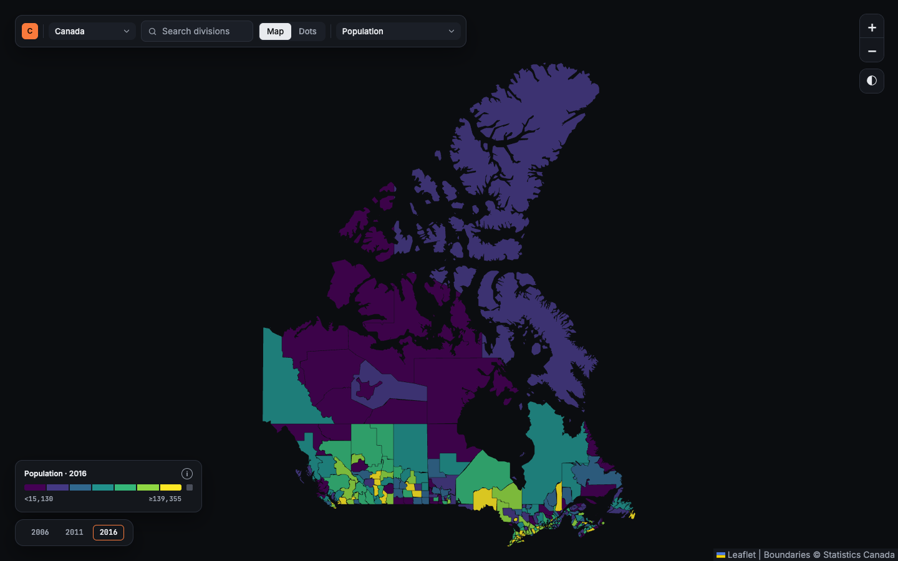
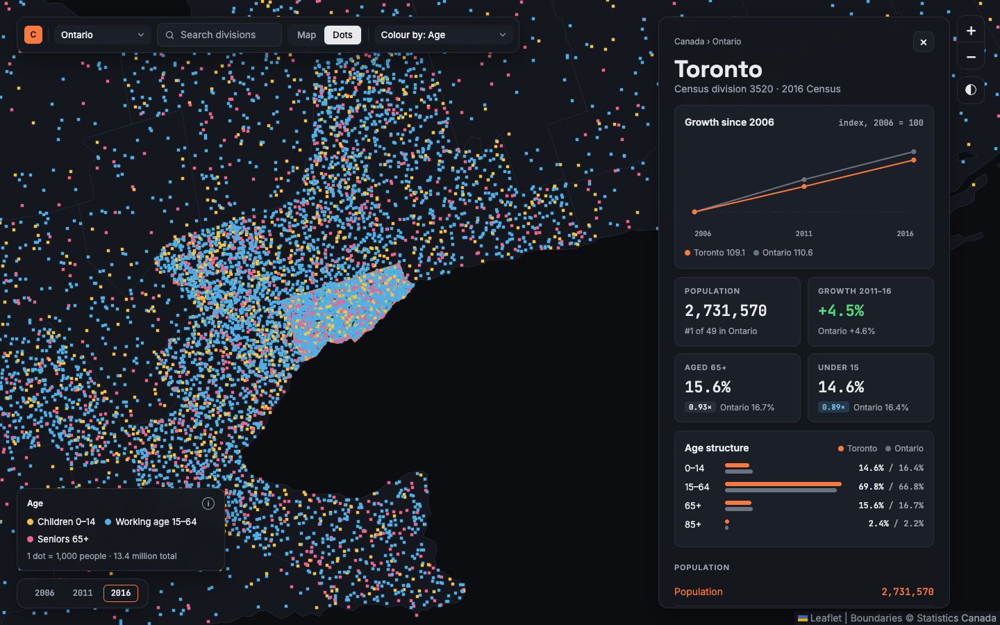
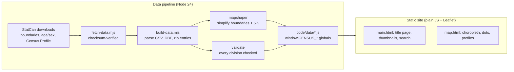

# Canadian Census Viewer

**Live site:** https://caelwynder.github.io/Canadian-Census-Viewer/



I downloaded Statistics Canada's 2016 Census tables and boundary files, built a pipeline that checks and packs them into three small data files, and mapped every one of Canada's 293 census divisions. Then I built a site to explore them. You land on a title page with live thumbnails. Open the map to colour every division by one of 27 measures, switch to a dot-density view, or click any division for its full profile.

It started in October 2024 as a map of ward populations in London, Ontario, grew to all of Ontario, then to all of Canada. Version 2 (October 2026) rebuilt it from the data up.

## What I ran

| | |
|---|---|
| Data | StatCan 2016 Census: Age and Sex tables, Census Profile, census division boundaries (~190 MB, checksum-verified) |
| Coverage | **293** census divisions across all 13 provinces and territories |
| Measures | **27** across population, age and sex, income, housing, immigration, language, education and work, and commuting |
| Census years | 2016 for every measure; 2006, 2011 and 2016 for age and population |
| Output | Boundaries simplified to 1.5% with mapshaper; **1.8 MB** of data across three JS files |
| Tests | **136** unit tests (`node:test`) and **11** browser tests (Playwright) |

## What you can do on the site



- **Colour the map:** pick any of the 27 measures, and step through 2006, 2011 and 2016 where the data exists.
- **Compare with Canada:** switch a measure to a red-to-green ramp showing how far each division sits above or below the national figure. Green marks the better side where one exists, such as lower unemployment or higher income.
- **Switch to dots:** one dot per 1,000 people or households, coloured by age, mother tongue, immigrant status or tenure.
- **Open a profile:** click a division for its growth chart, stat cards, age structure and every measure, set against its province or another division you pick.
- **Search and filter:** find any division by name, or narrow the map to one province or territory.
- **Pick a theme:** dark or light. Your choice carries across pages.
- **Share a view:** the URL holds the region, measure, view and division (`map.html?region=ontario&view=dots&cd=3520`).

## Architecture



There's no backend and no API keys. The data ships as JS globals loaded with `<script>` tags, so the site also opens straight from disk (`file://`), where browsers block `fetch()`. The map has no background tiles for the same reason. It deploys to GitHub Pages on every push to `code/`.

## Reproduce

```bash
git clone https://github.com/caelwynder/Canadian-Census-Viewer.git
cd Canadian-Census-Viewer
npm install

npm run data:fetch   # boundary file and Census Profile, ~190 MB
npm run data:build   # rebuilds code/data/*.js and validates every division
open code/main.html  # or any browser, no server needed
```

The generated data is committed, so you only need the two data steps to change or rebuild it.

Checks: `npm test && npm run test:e2e`. Needs Node 24 and Google Chrome. The browser tests run from `file://` and fail on any console error.

## Pipeline

| Stage | Script | Output |
|---|---|---|
| 1 | `scripts/fetch-data.mjs` | Downloads the boundary file and Census Profile into `code/data/raw/`, verifying SHA-256 checksums |
| 2 | `scripts/lib/boundaries.mjs` | Simplifies the division boundaries with mapshaper → `census-boundaries.js` |
| 3 | `scripts/lib/census-table.mjs` | Age and sex counts for 2006, 2011 and 2016 from the committed `code/data/output/` table → `census-age-sex-2016.js` |
| 4 | `scripts/lib/census-profile.mjs` | Income, housing, immigration, language, education and commuting → `census-profile-2016.js` |
| 5 | `scripts/lib/validate.mjs` | Checks every division has boundaries and figures before anything is written |

`scripts/build-data.mjs` runs stages 2–5. `code/js/metrics.js` defines all 27 measures in one place. The map, the legend and the profiles all read from it. `docs/phases/` records what each development phase added.

## Performance

| Page | Accessibility | Best practices | SEO |
|---|---|---|---|
| Title page (mobile) | 100 | 100 | 100 |
| Map with profile open (desktop) | 100 | 100 | 100 |

Lighthouse scores. Layout shift on the map page is 0.077, inside the "good" range.

## Read this before drawing conclusions

- **Dots aren't addresses.** The dot view scatters dots at random inside each division, so it shows how many people live there, not where.
- **The data stops at 2016.** Moving to the 2021 Census needs a new boundary set, because StatCan redrew some divisions.
- **Big divisions hide detail.** Kenora and Toronto are each one division, so a single colour can cover very different places.
- StatCan doesn't publish the low-income rate for the territories.
- Five divisions with incompletely enumerated reserves have no immigration figures.

## Credits

- **Census data:** Statistics Canada, 2016 Census: Age and Sex Highlight Tables (98-402-X2016002) and Census Profile (98-401-X2016050), under the [Open Government Licence – Canada](https://open.canada.ca/en/open-government-licence-canada)
- **Boundaries:** Statistics Canada, census division cartographic boundary file (lcd_000b16a_e)
- **Libraries:** [Leaflet](https://leafletjs.com/), [mapshaper](https://github.com/mbloch/mapshaper), [Playwright](https://playwright.dev/)

No license file yet, so all rights are reserved by default.
